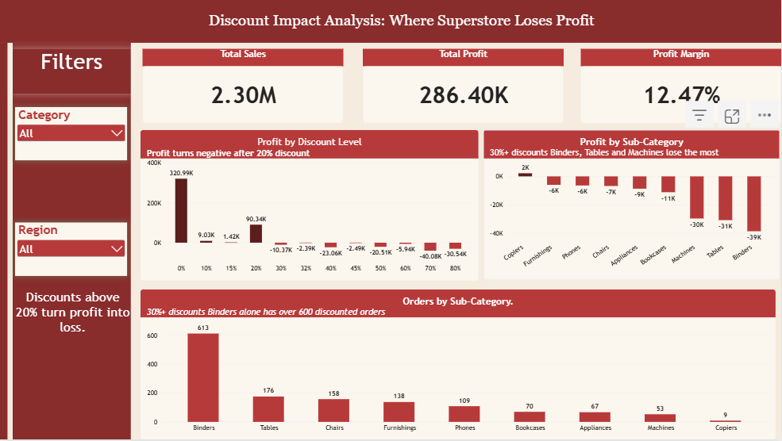

# Discount Impact Analysis: Where Superstore Loses Profit

## Question
Do high discounts turn profitable sales into losses?

## Data
Superstore Sales dataset from Kaggle: https://www.kaggle.com/datasets/vivek468/superstore-dataset-final

About 10,000 rows covering orders, products, discounts, sales and profit.

## Tools
Excel, Power Query, Power BI

## What I did
- Checked and cleaned the data in Power Query
- Added a Delivery Days column
- Built a Profit Margin measure
- Built a one-page dashboard to show the results

## Key findings
- Profit is positive up to a 20% discount and turns negative from 30% upward.
- At 30%+ discounts, almost every sub-category loses money.
- Binders, Tables and Machines lose the most.
- Binders has over 600 orders at 30%+ discounts.

## Recommendation
Cap discounts at 20% and review Binders, Tables and Machines first.

## Limitations
- This shows a link between discounts and losses, not proof that discounts alone cause them.
- I did not analyze shipping costs, regions or product costs.
- Supplies loses money even with low discounts, so it needs a separate look.

## Files
- Discount Analysis.pbix: the Power BI file
- Discount Impact Analysis.pdf: the dashboard as PDF
- dashboard2.png: screenshot of the dashboard

